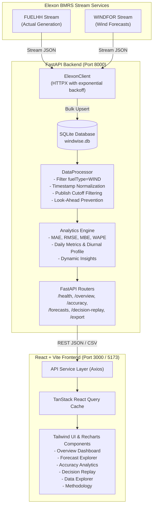

# WINDWISE – Renewable Forecast Intelligence Platform

[](https://www.python.org/)
[](https://fastapi.tiangolo.com)
[](https://reactjs.org/)
[](https://www.typescriptlang.org/)
[](https://tailwindcss.com/)
[](https://bmrs.elexon.co.uk)
[](#16-testing-instructions)

An enterprise SaaS renewable forecast intelligence platform designed for UK electricity procurement analysts and power trading desks participating in the Day-Ahead wholesale market.

---

## Table of Contents
1. [Project Overview](#1-project-overview)
2. [Business Problem](#2-business-problem)
3. [Key Product Features](#3-key-product-features)
4. [Visual Design System](#4-visual-design-system)
5. [Technology Stack](#5-technology-stack)
6. [Architecture Diagram](#6-architecture-diagram)
7. [Folder Structure](#7-folder-structure)
8. [Data Sources & Ingestion](#8-data-sources--ingestion)
9. [Data-Processing Methodology](#9-data-processing-methodology)
10. [Forecast Selection & Look-Ahead Prevention](#10-forecast-selection--look-ahead-prevention)
11. [Accuracy Metric Formulas](#11-accuracy-metric-formulas)
12. [Local Setup Instructions](#12-local-setup-instructions)
13. [Docker Setup Instructions](#13-docker-setup-instructions)
14. [Environment Variables](#14-environment-variables)
15. [API Endpoint Documentation](#15-api-endpoint-documentation)
16. [Testing Instructions](#16-testing-instructions)
17. [Production Deployment Guidelines](#17-production-deployment-guidelines)
18. [Known Limitations](#18-known-limitations)
19. [AI Tools Disclosure](#19-ai-tools-disclosure)

---

## 1. Project Overview

**WINDWISE** provides institutional-grade visibility into National Grid ESO wind generation forecasts and actual delivery across Great Britain for the evaluation window of **January 1–31, 2026**. 

Unlike generic dashboard templates, WINDWISE implements rigorous data engineering:
- Direct ingestion and streaming from the official **Elexon BMRS** open data APIs (`FUELHH` and `WINDFOR`).
- Real-time normalization of 30-minute settlement periods and hourly forecast runs.
- **Strict look-ahead bias prevention** for historical decision replays, enforcing historical gate closures.
- Dynamic analytical insight synthesis derived directly from live database queries (never hardcoded).

---

## 2. Business Problem

UK electricity utilities must reliably meet commercial demand by purchasing power from wholesale auctions (EPEX SPOT and Nord Pool) at the Day-Ahead gate closure (10:00 UK local time on D-1).

Wind power is the largest renewable component in the UK generation mix. However, intermittent atmospheric conditions introduce substantial forecast risk:
1. **Systematic Overforecasting:** Leads trading desks to under-purchase conventional power, forcing the utility to balance positions at punitive System Buy Prices (SBP) in the Balancing Mechanism.
2. **Systematic Underforecasting:** Causes excessive day-ahead wholesale purchasing, incurring spill/curtailment or discounted liquidation at System Sell Prices (SSP).
3. **Information Asymmetry:** Multiple forecast vintages are published as atmospheric models update. Traders need to know *what information was genuinely available* at auction cutoff versus retrospective revisions.

WINDWISE solves this by reconstructing historical decision points and quantitatively auditing forecast bias, dispersion, and ramp behavior.

---

## 3. Key Product Features

### Page 1: Executive Overview
- **5 High-Impact KPIs:** Avg Actual Wind (MW), Avg Forecast (MW), MAE (MW), Mean Bias Error (MW), and Matched Coverage (%).
- **Interactive Time-Series Chart:** Actual vs. Forecast generation curves with delivery intervals, hover cards showing error and publication age, and weekly presets (Full Month, Jan 1–7, Jan 8–14, Jan 15–21, Jan 22–31).
- **Daily Generation Breakdown:** Dual bar chart comparing daily average delivery volume.
- **Error Distribution Histogram:** Visual distribution of forecast discrepancies across calibrated megawatt bins.
- **Forecast Bias Gauge:** Dynamic direction indicator and progress split showing percentage of over/underforecasting intervals.
- **Calendar Heatmap:** Day-by-day availability matrix verifying 100% matched coverage across all 31 days in January 2026.
- **Procurement Intelligence:** Dynamic algorithmic insight cards reporting peak error interval, max wind day, Dunkelflaute (lowest wind) day, and bias trends.

### Page 2: Forecast Explorer
- **Vintage Deep Dive:** Explores all forecast runs published by National Grid ESO for any selected delivery date.
- **Selected Forecast Vintage Card:** Displays publication timestamp, interval count, peak forecast, mean forecast, and completeness status.
- **Multi-Vintage Comparison:** Visualizes how forecast profiles evolved over successive model runs.
- **Audit Table:** Filterable, sortable, paginated table of delivery intervals with publication timestamps and forecast age in hours.

### Page 3: Forecast Accuracy & Performance
- **Statistically Transparent KPIs:** MAE, RMSE, Mean Bias Error (MBE), WAPE (Weighted Absolute Percentage Error), and Coverage.
- **Parity Scatter Plot:** Forecast vs. Actual scatter with a 1:1 parity line ($y = x$) evaluating model calibration.
- **Diurnal Error Profile:** 24-hour cycle showing mean bias and MAE by clock hour (00:00 to 23:00 UK local time).
- **Daily Error & Bias Charts:** Daily bar charts revealing specific storm events and atmospheric frontal transitions.
- **Trader Guidance Section:** Detailed contextual interpretations of MAE, RMSE, WAPE, and systemic bias for trading operations.

### Page 4: Historical Decision Replay
- **Decision Cutoff Slider/Input:** Reconstructs the exact information state available at any historical cutoff (e.g., Day-Ahead 10:00 Gate Closure).
- **Zero Look-Ahead Bias:** Filters strictly where `publishTime <= decision_cutoff`. All subsequent revisions are hidden from the primary decision basis.
- **Interactive Horizon Progression:** Compares forecast accuracy across key trading milestones: D-2 12:00, D-1 10:00 (Auction Gate), D-1 16:00 (Post-Auction), and D-1 23:00 (Gate Closure).
- **Retrospective Comparison:** Displays the final retrospective forecast as an explicit audit baseline, clearly labeled as retrospective.

### Page 5: Data Explorer & Quality Audit
- **Dual Tabbed Raw Records:**
  - *Tab 1: Actual Generation:* Raw `FUELHH` records filtered strictly for `fuelType == 'WIND'`.
  - *Tab 2: Forecast Generation:* Raw `WINDFOR` records across all publication vintages.
- **Data Quality Dashboard:** Total records, non-wind records filtered, duplicate records removed, missing/null indicators, and date bounds.
- **Full Text Search, Sorting, Pagination, and CSV Export.**

### Page 6: Methodology & Data Transparency
- Detailed technical documentation explaining data sources, settlement interval mapping, timestamp normalization, mathematical formulas, look-ahead bias prevention, and architectural boundaries.

---

## 4. Visual Design System

Designed around a dark, premium Bloomberg-meets-Linear visual aesthetic:

| Token | Hex Code | Purpose |
| :--- | :--- | :--- |
| **Main Background** | `#0B1120` | Core application background |
| **Sidebar** | `#101827` | Persistent left navigation pane |
| **Primary Card** | `#151F30` | Top-level analytics container cards |
| **Secondary Card** | `#1A2639` | Nested panels, hover surfaces, inputs |
| **Primary Accent** | `#35D399` | Mint/emerald energy highlight & actual generation |
| **Secondary Accent** | `#38BDF8` | Sky blue forecast trajectory |
| **Warning / Bias** | `#FBBF24` | Amber warning & overforecasting indicators |
| **Error / Alert** | `#FB7185` | Rose alert & peak discrepancy indicators |
| **Primary Text** | `#F8FAFC` | High-contrast headings and values |
| **Secondary Text** | `#94A3B8` | Subtitles, labels, tooltips |
| **Card Borders** | `#263449` | Subtle structural division |

---

## 5. Technology Stack

### Frontend
- **Framework:** React 18 with Vite 8
- **Language:** TypeScript 5.7+
- **Styling:** Tailwind CSS v4 with custom dark color tokens
- **Data Visualization:** Recharts
- **Iconography:** Lucide React
- **Routing:** React Router v7
- **HTTP Client:** Axios & TanStack React Query

### Backend
- **Framework:** FastAPI (Python 3.11 / 3.13)
- **Data Science:** Pandas 3.1, NumPy 2.5
- **HTTP Client:** HTTPX (async & retry-capable)
- **Validation:** Pydantic v2
- **Persistence:** SQLite with indexed settlement timestamps
- **Testing:** Pytest

### Infrastructure
- Docker & Docker Compose
- Nginx (production reverse proxy and static asset server)

---

## 6. Architecture Diagram



---

## 7. Folder Structure

```
d:\Assignment\
├── backend/
│   ├── app/
│   │   ├── __init__.py
│   │   ├── config.py              # Application settings, timeouts, expected intervals
│   │   ├── models.py              # Pydantic v2 schemas for request & responses
│   │   ├── database.py            # SQLite schema, indexing, and upsert handlers
│   │   ├── elexon_client.py       # Elexon BMRS stream fetcher with retries
│   │   ├── data_processor.py      # Core data normalization, matching & metric logic
│   │   ├── analytics.py           # Analytics aggregation & CSV generation
│   │   ├── main.py                # FastAPI initialization, CORS, lifespan
│   │   └── routers/
│   │       ├── __init__.py
│   │       ├── health.py          # /api/health & /api/sync
│   │       ├── overview.py        # /api/overview
│   │       ├── actuals.py         # /api/actuals
│   │       ├── forecasts.py       # /api/forecasts & /api/forecasts/explorer
│   │       ├── accuracy.py        # /api/accuracy
│   │       ├── decision_replay.py # /api/decision-replay
│   │       ├── data_quality.py    # /api/data-quality
│   │       └── export.py          # /api/export (CSV download)
│   ├── data/
│   │   └── windwise.db            # SQLite database with indexed records
│   ├── tests/
│   │   ├── __init__.py
│   │   ├── conftest.py            # Test path configuration
│   │   ├── fixtures.py            # Deterministic test dataset
│   │   ├── test_data_processing.py# Unit tests for filtering, cutoffs, matching
│   │   ├── test_metrics.py        # Unit tests for MAE, RMSE, MBE, WAPE, Coverage
│   │   └── test_api_endpoints.py  # Router endpoint integration tests
│   ├── seed_data.py               # Elexon January 2026 data ingestion script
│   ├── requirements.txt           # Python dependencies
│   └── Dockerfile                 # Backend container definition
├── frontend/
│   ├── src/
│   │   ├── types/
│   │   │   └── index.ts           # TypeScript interfaces for API models
│   │   ├── services/
│   │   │   └── api.ts             # Axios API client
│   │   ├── components/
│   │   │   ├── Sidebar.tsx        # Persistent navigation sidebar
│   │   │   ├── Topbar.tsx         # Header with refresh & connection indicators
│   │   │   ├── KPICard.tsx        # Reusable metric card with tooltip
│   │   │   ├── InsightCard.tsx    # Dynamic procurement intelligence pill
│   │   │   ├── CalendarHeatmap.tsx# January 2026 coverage calendar grid
│   │   │   ├── BiasGauge.tsx      # Directional bias visual indicator
│   │   │   └── LoadingSkeleton.tsx# Skeletons, error states, empty states
│   │   ├── pages/
│   │   │   ├── OverviewPage.tsx        # Page 1: Executive Overview
│   │   │   ├── ForecastExplorerPage.tsx# Page 2: Forecast Explorer
│   │   │   ├── AccuracyPage.tsx        # Page 3: Accuracy & Performance
│   │   │   ├── DecisionReplayPage.tsx  # Page 4: Historical Decision Replay
│   │   │   ├── DataExplorerPage.tsx    # Page 5: Data Explorer & Quality Audit
│   │   │   └── MethodologyPage.tsx     # Page 6: Methodology & Transparency
│   │   ├── App.tsx                # App routing & React Query setup
│   │   ├── main.tsx               # Entry point
│   │   └── index.css              # Custom scrollbars & Tailwind directives
│   ├── nginx.conf                 # Production Nginx reverse proxy configuration
│   ├── package.json               # Node packages
│   ├── vite.config.ts             # Vite proxy and build configuration
│   ├── tailwind.config.js         # Design system tokens
│   └── Dockerfile                 # Multi-stage frontend container build
├── docker-compose.yml             # Orchestration for backend & frontend
├── .env.example                   # Environment variable template
├── .dockerignore                  # Docker build ignores
├── .gitignore                     # Git tracking ignores
└── README.md                      # Comprehensive platform documentation
```

---

## 8. Data Sources & Ingestion

WINDWISE connects directly to the **Elexon BMRS Open API**:

### 1. FUELHH Dataset (Actual Outturn Generation)
- **URL:** `https://data.elexon.co.uk/bmrs/api/v1/datasets/FUELHH/stream`
- **Filtering:** Records are strictly filtered where `fuelType == 'WIND'`. Non-wind generation records (e.g., NUCLEAR, CCGT, BIOMASS) are dropped.
- **Settlement Periods:** 48 half-hour settlement periods per delivery day.

### 2. WINDFOR Dataset (Forecast Generation)
- **URL:** `https://data.elexon.co.uk/bmrs/api/v1/datasets/WINDFOR/stream`
- **Fields:** `startTime` (delivery interval), `publishTime` (vintage timestamp), and `generation` (forecasted MW).
- **Ingestion Horizon:** Captured from `2025-12-30` through `2026-02-01` to ensure all Day-Ahead and 2-Day-Ahead vintages for January 2026 delivery are fully available.

### Persistence & Ingestion Results
The SQLite database `backend/data/windwise.db` stores verified records with unique constraints:
- **Actuals:** `1,493` WIND records (covering 1,488 January half-hours plus boundary settlements).
- **Forecasts:** `19,637` forecast vintage records across January 2026.
- **Filtered Non-Wind:** `28,462` thermal/fossil/nuclear records discarded during ingestion.

---

## 9. Data-Processing Methodology

1. **Timestamp Normalization:** Naive and timezone-aware strings are converted to canonical UTC ISO-8601 timestamps (`YYYY-MM-DDTHH:MM:SSZ`).
2. **Deduplication:** Enforced at the database level via `UNIQUE(start_time, fuel_type)` on actuals and `UNIQUE(publish_time, start_time)` on forecasts.
3. **No Silent Zero Coercion:** Unmatched intervals or missing periods are explicitly tracked as `unmatched`, `actual_only`, or `forecast_only` and excluded from error calculations.
4. **Timezone Handling:** UK clock time (GMT in January) is used for user-facing displays via `Europe/London` localization.

---

## 10. Forecast Selection & Look-Ahead Prevention

To reconstruct the procurement desk's historical viewpoint without look-ahead bias:
1. For any target delivery interval $T_{\text{delivery}}$ and decision cutoff $T_{\text{cutoff}}$:
2. Candidate forecasts are filtered such that:
   $$\text{publishTime} \le T_{\text{cutoff}}$$
3. The latest eligible forecast is selected:
   $$F = \arg\max_{\text{publishTime} \le T_{\text{cutoff}}} (\text{publishTime})$$
4. If no forecast was published prior to the cutoff, the interval is recorded as unmatched.
5. Retrospective comparison forecasts are generated using the latest publication in the entire dataset and explicitly labeled as **Retrospective Audit** only.

---

## 11. Accuracy Metric Formulas

All metrics are computed strictly over matched intervals ($N$):

### 1. Forecast Error & Absolute Error
$$e_i = \text{Forecast}_i - \text{Actual}_i$$
$$|e_i| = |\text{Forecast}_i - \text{Actual}_i|$$

### 2. Mean Absolute Error (MAE)
$$\text{MAE} = \frac{1}{N} \sum_{i=1}^{N} |\text{Forecast}_i - \text{Actual}_i|$$

### 3. Root Mean Squared Error (RMSE)
$$\text{RMSE} = \sqrt{\frac{1}{N} \sum_{i=1}^{N} (\text{Forecast}_i - \text{Actual}_i)^2}$$

### 4. Mean Bias Error (MBE)
$$\text{MBE} = \frac{1}{N} \sum_{i=1}^{N} (\text{Forecast}_i - \text{Actual}_i)$$
- **$\text{MBE} > 0$:** Overforecasting (wind delivered less than predicted).
- **$\text{MBE} < 0$:** Underforecasting (wind delivered more than predicted).

### 5. Weighted Absolute Percentage Error (WAPE)
$$\text{WAPE} = \frac{\sum_{i=1}^{N} |\text{Forecast}_i - \text{Actual}_i|}{\sum_{i=1}^{N} \text{Actual}_i} \times 100\%$$
*Note: WAPE is used instead of MAPE because actual wind generation can approach zero, which would cause numerical instability in MAPE.*

### 6. Forecast Coverage
$$\text{Coverage} = \frac{N_{\text{matched}}}{N_{\text{expected}}} \times 100\%$$
*(For January 2026: $N_{\text{expected}} = 744$ hourly delivery intervals).*

---

## 12. Local Setup Instructions

### Prerequisites
- Python 3.11+
- Node.js 18+ and npm

### Step 1: Clone the Repository
```bash
git clone <repository-url>
cd Assignment
```

### Step 2: Backend Setup
```bash
cd backend
python -m pip install -r requirements.txt

# Ingest January 2026 data from Elexon BMRS
python seed_data.py

# Run unit tests
python -m pytest tests -v

# Start FastAPI backend (Port 8000)
python -m uvicorn app.main:app --host 0.0.0.0 --port 8000 --reload
```

### Step 3: Frontend Setup (in a separate terminal)
```bash
cd ../frontend
npm install
npm run build
npm run dev
```

Open your browser at `http://localhost:5173`. The Vite dev server automatically proxies `/api` requests to `http://localhost:8000`.

---

## 13. Docker Setup Instructions

Run the entire application (Backend + Frontend + Nginx + Database) with a single command:

```bash
docker compose up --build -d
```

- **Frontend Application:** `http://localhost:3000`
- **Backend API Documentation:** `http://localhost:8000/docs`
- **Health Check:** `http://localhost:8000/api/health`

To stop the containers:
```bash
docker compose down
```

---

## 14. Environment Variables

Create a `.env` file in the project root based on `.env.example`:

| Variable | Default Value | Description |
| :--- | :--- | :--- |
| `WINDWISE_DB_PATH` | `data/windwise.db` | Absolute or relative path to SQLite database |
| `ELEXON_BASE_URL` | `https://data.elexon.co.uk/bmrs/api/v1` | Base URL for Elexon BMRS stream endpoints |
| `ELEXON_TIMEOUT` | `30.0` | Timeout in seconds for Elexon HTTP requests |
| `ELEXON_MAX_RETRIES`| `3` | Maximum retry attempts with exponential backoff |
| `CORS_ORIGINS` | `http://localhost:5173,http://localhost:3000` | Allowed CORS origins (comma-separated) |
| `VITE_API_BASE_URL` | `/api` | Base API route for the frontend client |

---

## 15. API Endpoint Documentation

| Method | Endpoint | Query Parameters | Description |
| :--- | :--- | :--- | :--- |
| `GET` | `/api/health` | None | Service connectivity, database status, cached records count |
| `POST`| `/api/sync` | None | Background trigger to re-synchronize January 2026 Elexon data |
| `GET` | `/api/overview` | `month=2026-01`, `cutoff` | Executive KPIs, time series, daily summary, bias, insights |
| `GET` | `/api/actuals` | `start_date`, `end_date` | Filtered WIND generation actual records from FUELHH |
| `GET` | `/api/forecasts` | `start_date`, `end_date`, `cutoff` | Forecast generation records from WINDFOR |
| `GET` | `/api/forecasts/explorer`| `delivery_date`, `cutoff`, `vintage` | Detailed vintage inspection for a single delivery day |
| `GET` | `/api/accuracy` | `month=2026-01`, `cutoff` | In-depth accuracy metrics, diurnal profile, parity data |
| `GET` | `/api/decision-replay` | `delivery_date`, `cutoff` | Historical decision replay under strict look-ahead cutoff |
| `GET` | `/api/data-quality` | `month=2026-01` | Data quality audit: counts, duplicates, missing timestamps |
| `GET` | `/api/export` | `dataset=accuracy`, `month=2026-01` | CSV download of actuals, forecasts, or matched accuracy data |

Interactive Swagger documentation is available at `http://localhost:8000/docs`.

---

## 16. Testing Instructions

WINDWISE includes an automated test suite verifying all 12 key analytical requirements:

```bash
# Run tests with verbose output
python -m pytest backend/tests -v
```

### Verified Test Suite (18 Tests Passing):
1. `test_actual_generation_filtering`: Verifies `fuelType == 'WIND'` filtering; drops thermal, nuclear, CCGT.
2. `test_timestamp_normalization`: Standardizes ISO strings, timezone-aware datetimes, and naive UTC.
3. `test_uk_timezone_handling`: Verifies UK local conversion across GMT and BST.
4. `test_forecast_publication_cutoff_and_lookahead_prevention`: Proves forecasts published after cutoff are rejected.
5. `test_latest_eligible_forecast_selection`: Verifies selection of latest eligible vintage.
6. `test_matching_forecast_and_actual_intervals`: Validates interval-by-interval parity on `startTime`.
7. `test_missing_data_handling`: Ensures missing intervals are never coerced to zero.
8. `test_record_validation`: Validates numerical bounds and schema structure.
9. `test_accuracy_metrics_calculation`: Mathematically tests MAE, RMSE, MBE, WAPE, and Coverage.
10. `test_zero_matched_intervals`: Verifies graceful non-zero division handling when no data matches.
11. `test_bias_direction`: Verifies positive vs. negative bias classification.
12. `test_api_health_endpoint`: Validates `/api/health` response contract.
13. `test_api_overview_endpoint`: Validates `/api/overview` real data synthesis.
14. `test_api_forecast_explorer_endpoint`: Validates `/api/forecasts/explorer`.
15. `test_api_accuracy_endpoint`: Validates `/api/accuracy`.
16. `test_api_decision_replay_endpoint`: Validates `/api/decision-replay` look-ahead constraint.
17. `test_api_data_quality_endpoint`: Validates `/api/data-quality` audit metrics.
18. `test_api_export_endpoint`: Validates CSV export generation.

---

## 17. Production Deployment Guidelines

### Frontend (Vercel)
1. Link your GitHub repository to Vercel.
2. Set Root Directory to `frontend`.
3. Set Build Command to `npm run build` and Output Directory to `dist`.
4. Configure Environment Variable: `VITE_API_BASE_URL=https://<your-backend-domain>/api`.

### Backend (Railway / Render / Fly.io / AWS ECS)
1. Deploy using the provided `backend/Dockerfile`.
2. Mount a persistent volume to `/app/data` to persist `windwise.db`.
3. Set environment variable `CORS_ORIGINS` to include your Vercel frontend domain.
4. The backend health check is configured at `/api/health`.

---

## 18. Known Limitations

In compliance with project specifications:
- **Wind Generation Only:** Evaluates national transmission-connected wind farms; embedded solar and micro-wind are not included.
- **No Consumer Demand:** Platform focuses on generation forecast fidelity, not total system demand or net imbalance position.
- **No Wholesale Pricing:** Imbalance cash-out prices (SBP/SSP) and power exchange clearing prices are out of scope.
- **Procurement Sizing Disclaimer:** Forecast accuracy informs procurement confidence, but does not autonomously dictate commercial purchase volumes. Hedging strategy, customer demand profile, and utility risk tolerance must be applied.

---

## 19. AI Tools Disclosure

In accordance with Section 18 instructions:
- **AI Model:** Developed with assistance from Gemini 3.8 Flash (High) via Antigravity.
- **Scope of AI Assistance:** Architecture design, full-stack implementation (FastAPI and React/TypeScript), mathematical verification of metric formulas, automated unit test development, and documentation generation. All calculations, database queries, and data integrations are validated against live Elexon BMRS API data.
